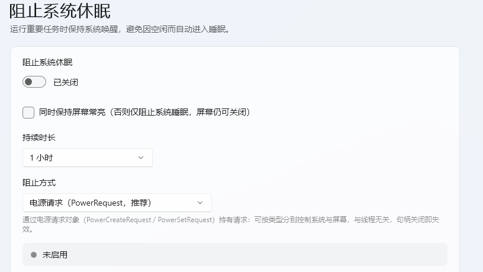

# wont-sleep

一个基于 **WinUI 3 / Windows App SDK** 的轻量系统工具，用于**阻止 Windows 进入睡眠**，避免在跑长时间任务（下载、编译、渲染、备份……）时因空闲而中断。

常驻通知区域，关闭窗口也不会退出，可随时从托盘一键开始或停止。

---

## 截图



---

## 功能特性

- **阻止系统休眠**：支持两种实现方式，可在界面中切换
  - 电源请求（`PowerCreateRequest` / `PowerSetRequest`，推荐）：与线程无关，可按类型分别控制系统与屏幕，句柄关闭即失效
  - 线程执行状态（`SetThreadExecutionState`）：兼容性最好，状态绑定在专用后台线程的生命周期上
- **屏幕常亮**：可选在阻止系统睡眠的同时保持显示器常亮
- **限时自动结束**：不限时 / 1 / 2 / 4 / 8 / 12 / 24 小时，倒计时结束后自动恢复系统默认电源策略
- **托盘常驻**：关闭窗口最小化到通知区域；托盘菜单可直接选择时长开始阻止、停止工作、显示窗口或退出
- **单实例**：重复启动不会产生第二个托盘图标，而是把已有窗口唤到前台继续使用
- **托盘状态反馈**：图标随状态变化（工作时睁眼、未启用时闭眼），悬停提示显示当前状态与结束时间
- **深色 / 浅色模式**：跟随系统 / 浅色 / 深色，同时作用于内容、标题栏按钮与 Mica 材质
- **多语言**：简体中文与英文，默认按系统首选语言自动匹配（无匹配时回退英文）
- **选项记忆**：屏幕常亮、时长、阻止方式与外观会跨会话保存

---

## 安装

推荐通过微软商店安装，自动获取更新：

[](https://apps.microsoft.com/detail/9NMZ86XJV794?hl=zh-cn&gl=CN&ocid=pdpshare)

也可以从构建产物手动安装 MSIX 包，见下文 [打包为 MSIX](#打包为-msix推荐)。

---

## 运行要求

| 项目 | 要求 |
| --- | --- |
| 操作系统 | Windows 10 1809（10.0.17763）及以上 |
| 运行时 | .NET 11（`net11.0-windows10.0.26100.0`） |
| SDK | Windows App SDK 2.6.5 |
| 支持架构 | x64、ARM64（不支持 x86） |
| 打包方式 | 单项目 MSIX（带包标识，`Package.appxmanifest`） |

---

## 构建与运行

```powershell
# 还原依赖
dotnet restore wont-sleep.csproj

# 构建（可选 x64 / ARM64）
dotnet build wont-sleep.csproj -c Debug -p:Platform=x64

# 运行（借助 Microsoft.Windows.SDK.BuildTools.WinApp 注册调试身份）
dotnet run --project wont-sleep.csproj -p:Platform=x64
```

也可以直接用 Visual Studio 打开 `wont-sleep.slnx`，选择目标平台后 F5 调试或部署。

> 首次运行前若图标或资源未生效，请重新部署一次（MSIX 布局是按部署步骤生成的）。

### 打包为 MSIX（推荐）

本项目是单项目 MSIX 应用，Release 构建可直接产出安装包。项目默认**不签名**（`AppxPackageSigningEnabled=false`）：微软商店入库时会重新签名，本地签名对上传没有意义。

```powershell
dotnet build wont-sleep.csproj -c Release -p:Platform=x64 `
  -p:GenerateAppxPackageOnBuild=true
```

产物位于 `AppPackages\wont-sleep_1.0.5.0_x64_Test\`：

| 文件 | 说明 |
| --- | --- |
| `wont-sleep_1.0.5.0_x64.msix` | 应用包（未签名，用于上传商店） |
| `Install.ps1` / `Add-AppDevPackage.ps1` | 安装脚本（未签名包无法直接安装） |
| `Dependencies\` | Windows App Runtime 依赖包 |

> 未签名包不能旁加载安装。需要在本地安装时，临时开启签名并指定证书（证书 `Subject` 必须与清单 `Identity Publisher` 完全一致）：
>
> ```powershell
> dotnet build wont-sleep.csproj -c Release -p:Platform=x64 -p:GenerateAppxPackageOnBuild=true `
>   -p:AppxPackageSigningEnabled=true `
>   -p:PackageCertificateKeyFile="<pfx 路径>" -p:PackageCertificatePassword="<密码>"
> ```
>
> `.pfx` / `.cer` 已在 `.gitignore` 中排除，请勿把签名私钥提交到仓库。

#### 多架构商店包（一条命令）

上传商店用多架构 bundle，`Build-StoreBundle.ps1` 已经把完整流程脚本化：x64 / ARM64 各打一个 `.msix`，再用 `makeappx` 合并成一个未签名的 `.msixbundle`，统一输出到 `StorePackages\`。

```powershell
powershell -ExecutionPolicy Bypass -File Build-StoreBundle.ps1
```

产物：

| 文件 | 说明 |
| --- | --- |
| `StorePackages\wont-sleep_1.0.5.0_x64_arm64.msixbundle` | 上传商店的包（未签名，约 16 MB） |

可选参数：

```powershell
# 只打单个架构（x64 或 ARM64）
powershell -ExecutionPolicy Bypass -File Build-StoreBundle.ps1 -Platforms x64

# 保留中间产物（StorePackages\_staging 下各架构 .msix），便于排查
powershell -ExecutionPolicy Bypass -File Build-StoreBundle.ps1 -KeepStaging
```

脚本行为：

- 版本号直接读取 `Package.appxmanifest` 的 `Identity/@Version`，bundle 与清单始终一致
- 每个架构用独立的 `AppxPackageDir` 暂存，避免互相覆盖；中间目录默认在结束时删除
- 只打包应用 `.msix`。`Dependencies\` 里是框架包，`makeappx bundle` 会报 `is not valid in the bundle because it's a framework package`
- 强制 `AppxPackageSigningEnabled=false`，与商店入库时重新签名保持一致

### Native AOT 发布（可选）

AOT 默认关闭，保证未安装 C++ 工具链的机器也能正常构建与打包；需要时显式开启：

```powershell
dotnet publish wont-sleep.csproj -c Release -p:Platform=x64 -p:PublishAot=true
```

前置条件：需要 **MSVC 链接器 + Windows SDK**（Visual Studio Installer 中安装「使用 C++ 的桌面开发」工作负载）。缺失时会报：

```
error : Platform linker not found. Ensure you have all the required prerequisites ...
```

> 若 Visual Studio 是 **Insiders / 预览版**，SDK 自带的 `findvcvarsall.bat` 可能找不到 C++ 组件（`vswhere` 未注册该组件 ID），从而报同样的链接器错误。此时可在「x64 Native Tools 命令提示符」里执行，并额外传 `-p:IlcUseEnvironmentalTools=true`，让链接器直接从环境变量 `PATH` / `LIB` 获取。

---

## 使用说明

1. 打开开关「阻止系统休眠」，系统即进入保持唤醒状态。
2. 需要连屏幕一起保持常亮时，勾选「同时保持屏幕常亮」。
3. 在「持续时长」中选择时间；选「不限时」则一直保持，直到手动停止或退出应用。
4. 关闭窗口不会退出应用，而是最小化到通知区域继续工作；右键托盘图标可：
   - 选择时长并立即开始阻止
   - 停止工作（未运行时置灰）
   - 显示主窗口 / 退出

退出应用、注销或重启系统后，系统会自动恢复默认电源策略。

---

## 实现原理

### 电源请求（默认）

```csharp
PowerCreateRequest(...)                 // 创建请求对象，附带可见的原因字符串
PowerSetRequest(handle, SystemRequired) // 阻止系统睡眠
PowerSetRequest(handle, DisplayRequired)// 可选：阻止屏幕关闭
CloseHandle(handle)                     // 请求随之失效
```

### 线程执行状态

```csharp
SetThreadExecutionState(ES_CONTINUOUS | ES_SYSTEM_REQUIRED [| ES_DISPLAY_REQUIRED]);
SetThreadExecutionState(ES_CONTINUOUS);   // 停止时清除
```

该 API 的状态是**线程级**的，因此由一个专用后台线程持有请求，停止时通过信号通知线程清理状态后退出。

两种实现都封装在 `ISleepInhibitor` 接口下，便于替换与扩展。

---

## 项目结构

```
wont-sleep/
├─ App.xaml(.cs)                   应用入口
├─ MainWindow.xaml(.cs)            主窗口：标题栏、托盘图标、关闭即隐藏
├─ MainPage.xaml(.cs)              主界面：开关、时长、方式、外观、状态显示
├─ Services/
│  ├─ ISleepInhibitor.cs           阻止休眠的抽象、方式枚举与工厂
│  ├─ PowerRequestInhibitor.cs     电源请求实现
│  ├─ ThreadExecutionStateInhibitor.cs  线程执行状态实现
│  ├─ TrayIcon.cs                  Win32 通知区域图标（Shell_NotifyIcon + 自绘菜单）
│  ├─ ThemeService.cs              主题统一应用（内容 / 标题栏 / Mica）
│  ├─ ThemedMicaBackdrop.cs        可指定主题的 Mica 背景
│  ├─ AppSettings.cs               用户选项
│  ├─ SettingsStore.cs             LocalSettings / 文本文件键值存储
│  ├─ Strings.cs                   本地化字符串访问
│  ├─ DurationOptions.cs           时长选项（下拉框与托盘菜单共用）
│  └─ TrayStatus.cs                托盘提示与状态同步的数据契约
├─ Strings/
│  ├─ zh-CN/Resources.resw         简体中文
│  └─ en-US/Resources.resw         英文
├─ Assets/                         MSIX 图标、启动画面等
│  └─ source/generate-icon.ps1     图标生成脚本（矢量绘制，睁眼 / 闭眼两套）
├─ Build-StoreBundle.ps1           商店包脚本：多架构 .msix → StorePackages\*.msixbundle
└─ Package.appxmanifest            MSIX 清单
```

---

## 配置存储位置

- 有包标识（正常部署运行）：`ApplicationData.Current.LocalSettings`，容器名 `wont-sleep`
- 无包标识（直接运行 exe）：`%LOCALAPPDATA%\wont-sleep\settings.txt`

---

## 多语言与主题

- 新增语言：在 `Strings/` 下创建 `<语言标记>/Resources.resw`，补齐与现有文件相同的键即可
- XAML 静态文案通过 `x:Uid` 绑定，代码文案通过 `Services/Strings` 读取
- 语言在启动时按系统首选语言确定，切换系统显示语言后需重启应用

---

## 图标的重新生成

图标为矢量绘制（非位图缩放），修改造型或配色后重跑脚本即可同时更新全部 MSIX 资源与两套 ICO：

```powershell
powershell -NoProfile -ExecutionPolicy Bypass -File Assets\source\generate-icon.ps1
```

> 该脚本必须保存为 **UTF-8 with BOM**，否则 Windows PowerShell 5.1 会按 ANSI 解析中文注释而报语法错误。

---

## 已知限制

- 托盘右键菜单为原生 Win32 菜单，只跟随系统主题，不随应用内的深色 / 浅色设置变化
- 「保持屏幕常亮」要求会话已解锁，锁屏状态下仅系统睡眠被阻止
- MSIX 磁贴与启动画面使用固定的「睁眼」图标，不随运行状态变化

---

## 许可证

本项目基于 [MIT License](LICENSE) 开源，Copyright (c) 2026 sunnysky123。
